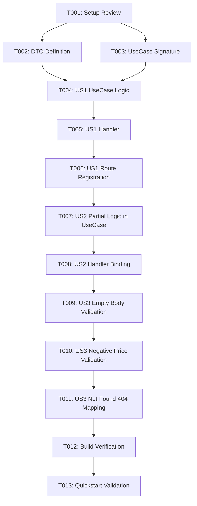

# Tasks: Topping Price Updates

**Feature**: `001-update-topping-prices`  
**Input**: Design artifacts from `specs/001-update-topping-prices/`  
**Spec**: [spec.md](spec.md) | **Plan**: [plan.md](plan.md)  

---

## Phase 1: Setup (Shared Infrastructure)

**Purpose**: Verify and prepare shared project routing and dependencies.

- [X] T001 Review existing catalog routes and middleware integration in `adapters/input/http/routes/url_mappings.go`

---

## Phase 2: Foundational (Blocking Prerequisites)

**Purpose**: Core DTOs and interface contracts that MUST be complete before user story implementation.

**⚠️ CRITICAL**: Foundational tasks must be completed before implementing user stories.

- [X] T002 Define `UpdateToppingPriceRequest` DTO with pointer floats (`SinglePrice *float64`, `ComboPrice *float64` with `validate:"omitempty,min=0"`) in `adapters/input/http/dto/catalog_dto.go`
- [X] T003 Declare `UpdateToppingPrices(id uint, singlePrice, comboPrice *float64) (*domain.Topping, error)` method signature in `core/usecase/catalog_usecase.go`

**Checkpoint**: Foundation ready - user story implementation can begin.

---

## Phase 3: User Story 1 - Full Topping Price Update (Priority: P1) 🎯 MVP

**Goal**: Allow authorized users to update both single price and combo price of an existing topping in a single atomic operation.

**Independent Test**: Send a PATCH request to `/api/toppings/:id/price` with both `single_price` and `combo_price` specified, and verify HTTP 200 response with updated values reflected in database and catalog lookups.

### Implementation for User Story 1

- [X] T004 [US1] Implement `UpdateToppingPrices` core logic in `core/usecase/catalog_usecase.go` to retrieve topping via `repo.GetByID(id)`, update both prices, and persist via `repo.Update(topping)`
- [X] T005 [US1] Implement `UpdateToppingPrices` handler method in `adapters/input/http/handlers/catalog_handler.go` parsing `:id`, binding `UpdateToppingPriceRequest`, delegating to `catalogUC`, and returning HTTP 200
- [X] T006 [US1] Register route `PATCH /api/toppings/:id/price` protected by `middleware.Protected()` in `adapters/input/http/routes/url_mappings.go`

**Checkpoint**: User Story 1 is fully functional and delivers an independently testable MVP.

---

## Phase 4: User Story 2 - Partial Price Update (Priority: P2)

**Goal**: Allow updating either only `single_price` or only `combo_price` without requiring re-entry or modification of the other price.

**Independent Test**: Send a PATCH request with only `single_price` (or only `combo_price`) and confirm that only the targeted price is modified while the other retains its pre-existing value.

### Implementation for User Story 2

- [X] T007 [US2] Update price assignment in `core/usecase/catalog_usecase.go` using nil-checks so non-nil pointer values update their respective fields while nil fields remain untouched
- [X] T008 [US2] Verify and handle partial payload binding in `adapters/input/http/handlers/catalog_handler.go` ensuring untouched fields are correctly passed as nil to use case

**Checkpoint**: User Stories 1 and 2 are functional and independently verifiable.

---

## Phase 5: User Story 3 - Price Validation and Error Controls (Priority: P3)

**Goal**: Validate that input prices are non-negative, reject empty payloads, and return HTTP 404 when updating nonexistent toppings.

**Independent Test**: Send requests with negative prices, empty JSON body `{}`, or nonexistent topping ID, and verify appropriate HTTP 400 and HTTP 404 responses with descriptive error messages.

### Implementation for User Story 3

- [X] T009 [US3] Add empty payload check in `adapters/input/http/handlers/catalog_handler.go` returning HTTP 400 when both `single_price` and `combo_price` are omitted
- [X] T010 [US3] Integrate `utils.ValidateStruct` in `adapters/input/http/handlers/catalog_handler.go` to reject negative numbers (prices < 0) with HTTP 400
- [X] T011 [US3] Map not found repository errors to HTTP 404 with error message in `adapters/input/http/handlers/catalog_handler.go`

**Checkpoint**: All user stories and error handling paths are completely operational.

---

## Phase 6: Polish & Cross-Cutting Concerns

**Purpose**: Verification and validation of the entire feature against design artifacts.

- [X] T012 Run Go build and static check (`go vet ./...`) across all packages from repository root
- [X] T013 Execute end-to-end scenarios documented in `specs/001-update-topping-prices/quickstart.md`

---

## Dependencies & Execution Order

### Phase Dependencies

- **Setup (Phase 1)**: Can start immediately.
- **Foundational (Phase 2)**: Depends on Setup (T001). Blocks all User Stories.
- **User Story 1 (Phase 3)**: Depends on Foundational (T002, T003). Delivers core MVP.
- **User Story 2 (Phase 4)**: Depends on User Story 1 (T004, T005, T006). Refines partial price logic.
- **User Story 3 (Phase 5)**: Depends on User Story 1 & 2. Adds validation and error boundaries.
- **Polish (Phase 6)**: Depends on completion of all user story tasks.

### User Story Dependencies

---

## Implementation Strategy

### MVP First (User Story 1 Only)

1. Complete Phase 1 (Setup) and Phase 2 (Foundational: DTO & signature).
2. Complete Phase 3 (User Story 1: UseCase, Handler, Route).
3. **Validate**: Test updating both prices on a topping via `PATCH /api/toppings/:id/price`.
4. Deploy or demo working MVP.

### Incremental Delivery

1. Foundation ready (T001–T003).
2. MVP delivered (T004–T006) → Both prices updatable.
3. Partial updates enabled (T007–T008) → Single price or combo price can be changed individually.
4. Validation & error handling secured (T009–T011) → Rejects negative values, empty bodies, and non-existent IDs.
5. Verification (T012–T013) → Final build and quickstart checks.
