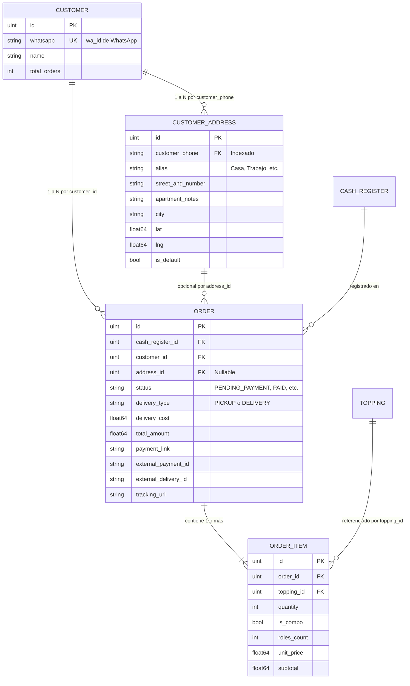

# Data Model: WhatsApp AI Ordering & Transactional Flow

## Entidades Principales

### 1. `CustomerAddress` (Nueva entidad 1:N con Cliente)
Almacena las distintas direcciones asociadas al teléfono de WhatsApp del cliente (`wa_id`). Un cliente puede tener múltiples direcciones (ej: "Casa", "Oficina", "Depto").

- **Tabla**: `customer_address`
- **Campos**:
  - `id`: `uint` (Primary Key, AutoIncrement)
  - `customer_phone`: `string` (`varchar(20)`, not null, index) — Coincide con `Customer.Whatsapp` (`wa_id`)
  - `alias`: `string` (`varchar(50)`, default "Casa") — Etiqueta amigable elegida por el cliente
  - `street_and_number`: `string` (`varchar(255)`, not null) — Calle y número
  - `apartment_notes`: `string` (`varchar(255)`) — Piso, departamento, timbre o referencias adicionales
  - `city`: `string` (`varchar(100)`, default "CABA") — Ciudad / Localidad
  - `lat`: `float64` (`default: 0.0`) — Latitud geográfica para geocodificación o Uber Direct
  - `lng`: `float64` (`default: 0.0`) — Longitud geográfica
  - `is_default`: `bool` (`default: false`) — Marca si es la dirección predeterminada
  - `created_at`: `time.Time`
  - `updated_at`: `time.Time`
  - `deleted_at`: `gorm.DeletedAt` (Index)

---

### 2. `Order` (Extensión de Entidad Existente)
Ampliación de la tabla `order` para soportar el ciclo de vida transaccional con pagos y envíos en línea sin distorsionar el arqueo de caja con pedidos impagos.

- **Campos Nuevos y Modificados**:
  - `status`: `OrderStatus` (`varchar(30)`, default `'PENDING_PAYMENT'`, not null)
    - Valores válidos:
      - `PENDING_PAYMENT` (Pedido creado a la espera del pago de Mercado Pago; no suma al total de caja)
      - `PAID` (Pago confirmado por webhook o verificación manual; computa en caja)
      - `PREPARING` (En preparación en cocina)
      - `DISPATCHED` (Despachado con cadete o Uber Direct)
      - `DELIVERED` (Entregado al cliente)
      - `COMPLETED` (Completado tradicional en mostrador)
      - `CANCELLED` (Cancelado o expirado sin pago)
  - `delivery_type`: `DeliveryType` (`varchar(20)`, default `'PICKUP'`, not null)
    - Valores: `PICKUP`, `DELIVERY`
  - `address_id`: `*uint` (nullable, index, foreignKey a `CustomerAddress.ID`)
  - `delivery_cost`: `float64` (`default: 0.0`) — Costo de envío cotizado por `DeliveryProvider`
  - `total_amount`: `float64` (Suma total = subtotal de productos + `delivery_cost`)
  - `payment_link`: `string` (`varchar(500)`) — Enlace de pago de Mercado Pago Checkout Pro
  - `external_payment_id`: `string` (`varchar(100)`) — ID de la preferencia / pago de Mercado Pago
  - `external_delivery_id`: `string` (`varchar(100)`) — ID de entrega generado por Uber Direct
  - `tracking_url`: `string` (`varchar(500)`) — URL en vivo de seguimiento de Uber Direct

---

### 3. `Customer` (Existente)
- `id`: `uint` (PK)
- `name`: `string` (`varchar(100)`)
- `whatsapp`: `string` (`varchar(20)`, uniqueIndex) — Coincide con `wa_id`
- `total_orders`: `int`
- `first_order_at`: `*time.Time`

---

## Diagrama de Relaciones Entidad-Relación

