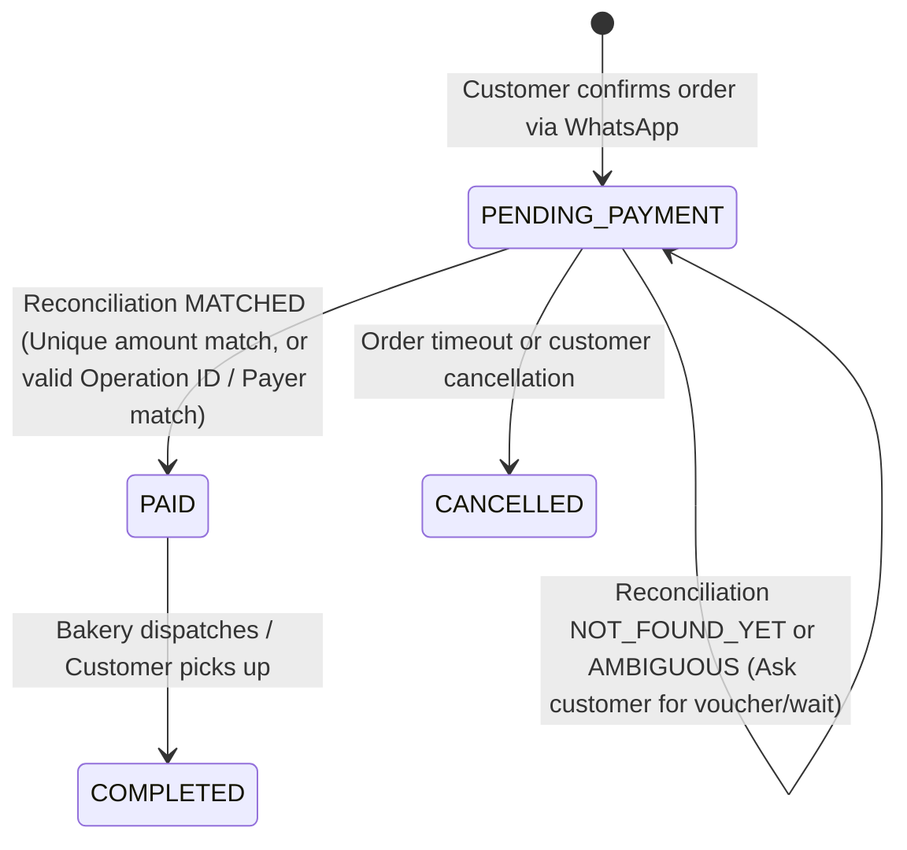

# Data Model: Automatic Transfer Reconciliation

**Feature**: `004-transfer-reconciliation`  
**Date**: 2026-10-16  

---

## 1. Domain Entities & Value Objects

### 1.1 PaymentTransaction (Pure Domain Entity)

Represents an incoming monetary transaction processed by the payment provider (e.g., Mercado Pago transfer to Alias/CVU).

| Field | Type | Description |
| :--- | :--- | :--- |
| `ID` | `string` | Unique external transaction/operation ID (e.g., `"123456789"`) |
| `Amount` | `float64` | Total monetary amount credited |
| `Currency` | `string` | ISO currency code (strictly `"ARS"`) |
| `DateApproved` | `time.Time` | Timestamp when the transaction was accredited |
| `OperationType` | `string` | Nature of operation (e.g., `"bank_transfer"`, `"money_transfer"`) |
| `PayerName` | `string` | Full name of the originating account holder |
| `PayerIdentification` | `string` | DNI, CUIT, or national identifier of sender (if provided) |
| `Status` | `string` | Transaction status in provider (`"approved"`, `"in_process"`, `"rejected"`) |

### 1.2 ReconciliationStatus (Enum)

State of the reconciliation matching attempt.

```go
type ReconciliationStatus string

const (
    ReconciliationStatusMatched                  ReconciliationStatus = "MATCHED"
    ReconciliationStatusNotFoundYet              ReconciliationStatus = "NOT_FOUND_YET"
    ReconciliationStatusAmbiguousMultipleMatches ReconciliationStatus = "AMBIGUOUS_MULTIPLE_MATCHES"
    ReconciliationStatusAmountMismatch           ReconciliationStatus = "AMOUNT_MISMATCH"
    ReconciliationStatusAlreadyUsed              ReconciliationStatus = "ALREADY_USED"
)
```

### 1.3 ReconciliationResult (Value Object)

Summary of a reconciliation attempt executed by the use case.

| Field | Type | Description |
| :--- | :--- | :--- |
| `Status` | `ReconciliationStatus` | Deterministic outcome of the reconciliation |
| `OrderID` | `uint` | Local order ID evaluated |
| `MatchedTransaction` | `*PaymentTransaction` | The transaction associated with the order (if matched) |
| `CandidateCount` | `int` | Number of candidate transactions found in the time window |
| `Message` | `string` | User-friendly explanation designed for customer communication |

---

## 2. Updated Domain Entities

### 2.1 Order (`core/domain/order.go`)

Modifications to the core `Order` entity to support direct transfer reconciliation and audit tracking.

```go
type Order struct {
    ID                uint            `gorm:"primaryKey" json:"id"`
    CustomerID        uint            `gorm:"not null" json:"customer_id"`
    Customer          Customer        `gorm:"foreignKey:CustomerID" json:"customer"`
    CashRegisterID    uint            `gorm:"not null" json:"cash_register_id"`
    DeliveryType      DeliveryType    `gorm:"type:varchar(20);not null" json:"delivery_type"`
    AddressID         *uint           `json:"address_id"`
    Address           *CustomerAddress`gorm:"foreignKey:AddressID" json:"address"`
    DeliveryCost      float64         `gorm:"type:decimal(10,2);default:0.00" json:"delivery_cost"`
    TotalAmount       float64         `gorm:"type:decimal(10,2);not null" json:"total_amount"`
    Status            OrderStatus     `gorm:"type:varchar(20);not null;default:'PENDING_PAYMENT'" json:"status"`
    PaymentMethod     string          `gorm:"type:varchar(30);default:'TRANSFER_ALIAS'" json:"payment_method"`
    ExternalPaymentID string          `gorm:"type:varchar(100);index" json:"external_payment_id"`
    PaymentLink       string          `gorm:"type:varchar(255)" json:"payment_link"` // Deprecated in favor of Alias
    PaidAt            *time.Time      `json:"paid_at"`
    Items             []OrderItem     `gorm:"foreignKey:OrderID" json:"items"`
    CreatedAt         time.Time       `json:"created_at"`
    UpdatedAt         time.Time       `json:"updated_at"`
    DeletedAt         gorm.DeletedAt  `gorm:"index" json:"-"`
}
```

---

## 3. Lifecycle & State Machine Transitions



### Transition Validation Rules

1. **`PENDING_PAYMENT` -> `PAID`**:
   - `order.TotalAmount == transaction.Amount`.
   - `transaction.Currency == "ARS"`.
   - `transaction.Status == "approved"`.
   - `transaction.ID` does NOT exist in any other order (`COUNT(orders WHERE external_payment_id = transaction.ID) == 0`).
   - Sets `order.ExternalPaymentID = transaction.ID` and `order.PaidAt = now`.
