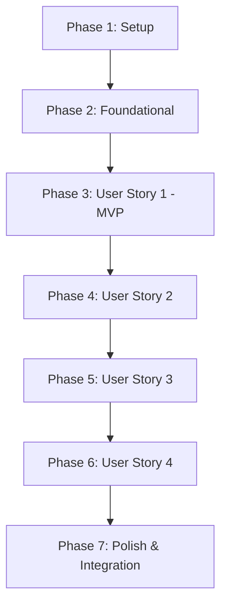

............# Implementation Tasks: Automatic Transfer Reconciliation (Mercado Pago Alias/CVU)

**Feature**: `004-transfer-reconciliation`  
**Plan**: [specs/004-transfer-reconciliation/plan.md](plan.md)  
**Spec**: [specs/004-transfer-reconciliation/spec.md](spec.md)  

---

## Phase 1: Setup (Shared Infrastructure)

**Purpose**: Define the pure domain entities, ports, and value objects required across all user stories.

- [X] T001 [P] Define `PaymentTransaction` entity, `ReconciliationStatus` enum, and `ReconciliationResult` value object in `core/domain/payment_transaction.go`
- [X] T002 [P] Update `domain.Order` entity with `PaymentMethod` (default `'TRANSFER_ALIAS'`) and `PaidAt` timestamp fields in `core/domain/order.go`
- [X] T003 [P] Extend `output.PaymentProvider` port interface with `SearchApprovedTransfers` and `GetTransferByID` in `ports/output/payment_provider.go`
- [X] T004 [P] Define `input.PaymentReconciliationUseCasePort` and `DisambiguationOptions` in `ports/input/payment_reconciliation_port.go`

---

## Phase 2: Foundational (Blocking Prerequisites)

**Purpose**: Core infrastructure, provider adapters, and reconciliation use case that MUST be complete before user story integration.

**⚠️ CRITICAL**: No user story work can begin until this phase is complete.

- [X] T005 [P] Implement in-memory mock bank transfer ledger with `SeedTransfer` and `ClearTransfers` in `adapters/output/payment/mock_payment_provider.go`
- [X] T006 Implement `SearchApprovedTransfers` and `GetTransferByID` HTTP client methods against `/v1/payments/search` and `/v1/payments/{id}` in `adapters/output/payment/mercadopago_provider.go`
- [X] T007 Implement `PaymentReconciliationUseCase` with candidate searching, anti-double-spending checks, and state machine transitions in `core/usecase/payment_reconciliation_usecase.go`
- [X] T008 [P] Write unit tests for `PaymentReconciliationUseCase` covering all 5 outcomes (`MATCHED`, `NOT_FOUND_YET`, `AMBIGUOUS_MULTIPLE_MATCHES`, `AMOUNT_MISMATCH`, `ALREADY_USED`) in `core/usecase/payment_reconciliation_usecase_test.go`

**Checkpoint**: Core reconciliation engine ready - user story implementation can now proceed.

---

## Phase 3: User Story 1 - Order Confirmation with Direct Transfer Instructions (Priority: P1) 🎯 MVP

**Goal**: Deliver the official CaneRollss transfer receipt (Total, Alias `Caneroll.mp`, Titular `Ivonne Abreu`) and register the order in `PENDING_PAYMENT` without checkout links.

**Independent Test**: Create an order via WhatsApp agent and verify the order is stored with status `PENDING_PAYMENT`, payment method `TRANSFER_ALIAS`, and the returned message includes Alias `Caneroll.mp` and holder `Ivonne Abreu`.

- [X] T009 [US1] Update `cinnamon_sales_agent.tmpl` to format the official CaneRollss transfer receipt (Alias `Caneroll.mp`, Titular `Ivonne Abreu`, Total) in `core/usecase/prompts/cinnamon_sales_agent.tmpl`
- [X] T010 [US1] Remove Checkout Pro payment link generation and ensure orders are created with `PaymentMethod: "TRANSFER_ALIAS"` and status `PENDING_PAYMENT` in `core/usecase/whatsapp_agent_usecase.go`
- [X] T011 [US1] Update unit tests to verify receipt copy and order creation without payment links in `core/usecase/whatsapp_agent_usecase_test.go`

**Checkpoint**: User Story 1 functional and independently testable as MVP.

---

## Phase 4: User Story 2 - On-Demand Conversational Transfer Reconciliation (Priority: P1)

**Goal**: Enable the customer to notify "Ya transferí" in WhatsApp, triggering automated verification against Mercado Pago and transitioning the order to `PAID`.

**Independent Test**: Simulate an order in `PENDING_PAYMENT` for $8.500, seed a matching transfer in the mock provider, send "Ya transferí", and verify order status transitions to `PAID` with external payment ID recorded.

- [X] T012 [US2] Wire `PaymentReconciliationUseCase` into `NewWhatsAppAgentUseCase` and define tool declaration for `verificar_estado_pago` in `core/usecase/whatsapp_agent_usecase.go`
- [X] T013 [US2] Implement tool execution for `verificar_estado_pago` calling `ReconcileCustomerOrder` in `core/usecase/whatsapp_agent_usecase.go`
- [X] T014 [US2] Update `cinnamon_sales_agent.tmpl` state machine and examples so Roli invokes `verificar_estado_pago` when customer says 'ya pagué' or 'ya transferí' in `core/usecase/prompts/cinnamon_sales_agent.tmpl`
- [X] T015 [US2] Add unit test verifying conversational tool execution and transition of order to `PAID` upon exact transfer match in `core/usecase/whatsapp_agent_usecase_test.go`

**Checkpoint**: User Stories 1 and 2 functional and independently testable.

---

## Phase 5: User Story 3 - Ambiguity Resolution and Discrepancy Handling (Priority: P2)

**Goal**: Prevent false positives and double-spending by detecting duplicate amounts, uncredited transfers, and amount mismatches, guiding the customer with actionable steps.

**Independent Test**: Simulate ambiguous concurrent transfers and verify Roli asks for the operation ID/payer name; provide operation ID and verify successful resolution.

- [X] T016 [US3] Implement customer disambiguation parsing for operation ID, voucher number, and payer name in `core/usecase/whatsapp_agent_usecase.go`
- [X] T017 [US3] Enrich `cinnamon_sales_agent.tmpl` prompt rules and examples to handle `AMBIGUOUS_MULTIPLE_MATCHES`, `NOT_FOUND_YET`, and `AMOUNT_MISMATCH` warmly in `core/usecase/prompts/cinnamon_sales_agent.tmpl`
- [X] T018 [US3] Add unit tests for disambiguation flows (operation ID match, waiting on uncredited transfer, duplicate usage rejection) in `core/usecase/whatsapp_agent_usecase_test.go`

**Checkpoint**: Ambiguity and discrepancy handling fully operational.

---

## Phase 6: User Story 4 - Reactive Webhook Ingestion & Notification (Priority: P3)

**Goal**: Ingest real-time Mercado Pago payment webhooks with HMAC signature verification, reconcile matching pending orders proactively, and dispatch WhatsApp confirmation.

**Independent Test**: Post a simulated webhook event with valid HMAC header and verify matching pending order is transitioned to `PAID`.

- [X] T019 [US4] Update `MercadoPagoHandler` to inject `PaymentReconciliationUseCasePort` and trigger `ReconcileIncomingTransfer` in `adapters/input/http/handlers/mercadopago_handler.go`
- [X] T020 [US4] Implement HMAC-SHA256 `x-signature` header validation with `MP_WEBHOOK_SECRET` in `adapters/input/http/handlers/mercadopago_handler.go`
- [X] T021 [US4] Add webhook integration test verifying incoming payment notification automatically marks matching order as `PAID` in `tests/reconciliation_webhook_test.go`

**Checkpoint**: End-to-end reactive webhook flow operational.

---

## Phase 7: Polish & Cross-Cutting Integration

**Purpose**: Dependency injection wiring, environment variables, documentation, and full test suite validation.

- [X] T022 Update `app/app.go` dependency injection wiring for `PaymentReconciliationUseCase`, `MercadoPagoHandler`, and `WhatsAppAgentUseCase` in `app/app.go`
- [X] T023 Update `.env.example` and `.env` with `MP_WEBHOOK_SECRET` and configuration notes in `.env.example`
- [X] T024 Update end-to-end integration flow in `tests/e2e_test.go` to validate the complete Alias transfer ordering lifecycle
- [X] T025 Run full test suite (`go test ./...`) and execute quickstart validation scenarios in `specs/004-transfer-reconciliation/quickstart.md`

---

## Dependencies & Execution Order

### Phase Dependencies



### User Story Dependencies

- **User Story 1 (P1)**: Depends on Phase 2 completion. Delivers the MVP order flow with Alias `Caneroll.mp`.
- **User Story 2 (P1)**: Depends on US1 completion. Enables conversational transfer reconciliation.
- **User Story 3 (P2)**: Extends US2 by supporting disambiguation parameters and edge cases.
- **User Story 4 (P3)**: Depends on Phase 2 & US2 reconciliation logic for webhook event dispatch.

---

## Parallel Execution Examples

### Parallel Group 1: Phase 1 Setup
```text
Task T001: Define PaymentTransaction in core/domain/payment_transaction.go
Task T002: Update domain.Order in core/domain/order.go
Task T003: Extend PaymentProvider in ports/output/payment_provider.go
Task T004: Define PaymentReconciliationUseCasePort in ports/input/payment_reconciliation_port.go
```

### Parallel Group 2: Phase 2 Foundational
```text
Task T005: MockPaymentProvider in adapters/output/payment/mock_payment_provider.go
Task T008: Unit tests in core/usecase/payment_reconciliation_usecase_test.go
```

---

## Implementation Strategy

### MVP First (User Story 1 & 2)

1. **Step 1**: Complete Phase 1 (Domain & Ports).
2. **Step 2**: Complete Phase 2 (Foundational engine & mock ledger).
3. **Step 3**: Implement User Story 1 (Receipt with Alias `Caneroll.mp`).
4. **Step 4**: Implement User Story 2 (On-demand conversational verification).
5. **Validate**: Test multi-turn order and payment confirmation locally via `POST /chat`.

### Incremental Delivery

- **Increment 1**: Order placement with official Alias `Caneroll.mp` receipt (US1).
- **Increment 2**: Conversational "Ya transferí" verification (US2).
- **Increment 3**: Disambiguation for operation ID / voucher / sender name (US3).
- **Increment 4**: Asynchronous webhook ingestion with HMAC validation (US4).
- **Increment 5**: Full E2E regression and live verification (Phase 7).
